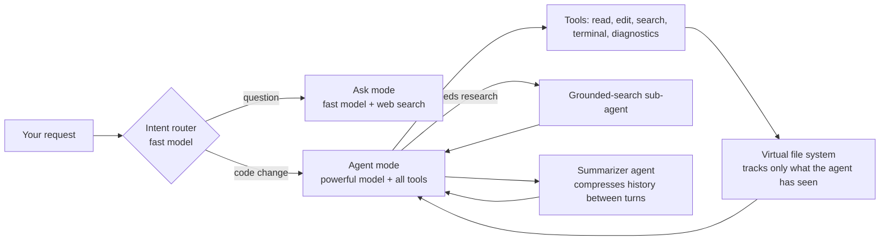

# Sequence Code

**A multi-agent AI coding assistant for VS Code that plans, edits, and verifies code on its own.**

Designed and directed by [Tayyab Raza](https://www.linkedin.com/in/tayyab3245) · implemented with AI coding agents · TypeScript, Python

<!-- DEMO: drag your .mp4 into this README in GitHub's web editor (keep it under ~10 MB). It will play inline here. -->

**Watch the demo:** [LinkedIn post](LINKEDIN_POST_URL) · [Project site](PROJECT_SITE_URL)

---

## What it does

You describe a task in VS Code. Sequence decides whether it's a question or a code change, reads only the files it needs, edits them through tools, checks the results, and keeps going until the task is done.

## How it works

## Design decisions

- **Multi-agent routing.** A lightweight router classifies each request and picks a fast model for questions or a powerful model for code changes, so simple requests stay cheap.
- **A sub-agent disguised as a tool.** Gemini can't combine function calling and Google Search grounding in one request. So the main agent calls what looks like a normal search tool, which is really a separate Gemini call that can only search. The research comes back as a tool result, and the main agent never breaks its tool chain.
- **Memory that retrieves instead of loading everything.** Semantic search pulls only the relevant history, cutting context from **~15K to 2–4K tokens (70–85% fewer)**.
- **A virtual file system.** The agent only "knows" code it has actually read, edits through tools that return receipts, and gets fresh state every step instead of its full, ever-growing history.
- **Safety rails.** Loop detection and a turn cap stop runaway runs.

## How I tested it

I used Sequence Code as a daily user and treated every failure as a design problem:

- **Breaking it on purpose:** gave it real tasks, logged where it failed (wrong file, lost context, loops), then redesigned the memory, prompts, or tools.
- **Prompt design:** rewrote system prompts to remove contradictions and give the agent a clear identity and environment.
- **Token and model cost:** measured where tokens were burned and moved simple work to cheaper models.
- **Head-to-head:** compared it with GitHub Copilot on the same task. <!-- TODO: confirm the exact result, e.g. "Sequence finished in 1 step vs 2 for Copilot" --> RESULT_HERE

## Source

This is a showcase repository. The source code is private while the product is in development. **Source available on request.**
