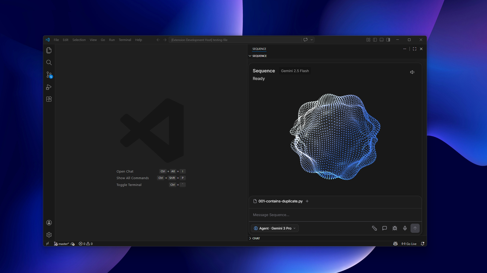
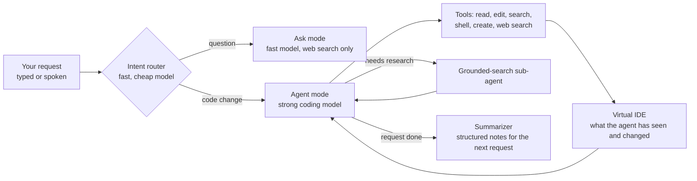

# Sequence Code

**An AI pair programmer for VS Code. It routes each request to the right model, edits code through a small set of tools, and keeps its own picture of the workspace while it works.**

Designed and directed by [Tayyab Raza](https://www.linkedin.com/in/tayyab3245) · implemented with AI coding agents · TypeScript, Python

▶ **[Watch the demo on sequenceai.ca](https://sequenceai.ca/products/sequence-code/#demo)**

---

## What it does

Sequence Code is a VS Code extension with a chat panel and an optional voice mode. You describe what you want. Sequence works out whether you asked a question or want code changed, then answers or makes the change itself: it reads only the files it needs, edits them, runs terminal commands, checks the result, and keeps going until the task is done.

It also includes an algorithm-practice workspace: a problem catalog grouped by pattern, progress tracking, and a coach you can talk to while you solve problems.

## How it works

Each request runs as a loop. The agent calls tools, the results update its view of the workspace, and it keeps going until it stops calling tools, hits a safety limit, or finishes.

## Design decisions

- **Route first, then pick the model.** A small, cheap model classifies every request as a question or a code change. Questions go to a fast model that can only search the web. Code changes go to a stronger coding model with the full tool set. If the router isn't available, a simple rule-based classifier takes over.
- **A sub-agent that looks like a tool.** Gemini can't combine function calling and Google Search grounding in one request. So the main agent calls what looks like an ordinary `googleSearch` tool. Behind it is a separate Gemini call that can only search. The answer comes back as a tool result, and the main agent's tool loop never breaks.
- **A virtual IDE, not the whole repo.** The agent only "knows" the code it has actually read. Every tool returns a receipt, and the receipts update a sparse model of the workspace: the file regions it has seen, the last change per line, live errors, and a short, capped directory tree that follows `.gitignore`. Files it hasn't touched for a couple of turns drop out of the prompt, so context doesn't grow forever.
- **Few tools, each doing more.** The agent works with six tools (read, edit, search, shell, create, web search) instead of dozens of small ones. Compiler errors appear in its workspace view automatically, so it never has to ask for them.
- **Summaries instead of transcripts.** When a request finishes, a cheap model pulls out structured notes: bugs fixed, features added, files changed, commands run, current focus, and open tasks. Each list keeps only its most recent entries. The next request starts from those notes, not from the full chat history.
- **Safety rails.** Loop detection watches for three patterns: the same call repeated, endless variations of one tool, and two tools ping-ponging (fix, fail, revert, fail). A hard cap of 20 turns per request backs it up.
- **More than one model provider.** Gemini is the default. OpenAI and Anthropic models work through the same provider interface, and expensive models are blocked unless chosen on purpose.
- **Voice.** Speech-to-text runs locally with Whisper. Replies are spoken back with text-to-speech, while an animated 3D orb shows when Sequence is listening, thinking, or talking.

## How I tested it

I used Sequence Code every day and treated every failure as a design problem:

- **Breaking it on purpose:** gave it real tasks, logged where it failed (wrong file, lost context, loops), then redesigned the memory, prompts, or tools.
- **Reading the raw prompts:** every model call can be captured to disk, so I could see exactly what the model saw and where tokens were being wasted.
- **Prompt design:** rewrote system prompts to remove contradictions and give the agent a clear identity and an accurate picture of its environment (for example, Windows PowerShell rather than Unix commands).
- **Token and model cost:** measured where tokens went and moved simple work (routing, summaries) to the cheapest models.

## Status

In active development. A cloud version of the orchestration loop is being built.

## Source

This is a showcase repository. The source code is private while the product is in development. **Source available on request.**
